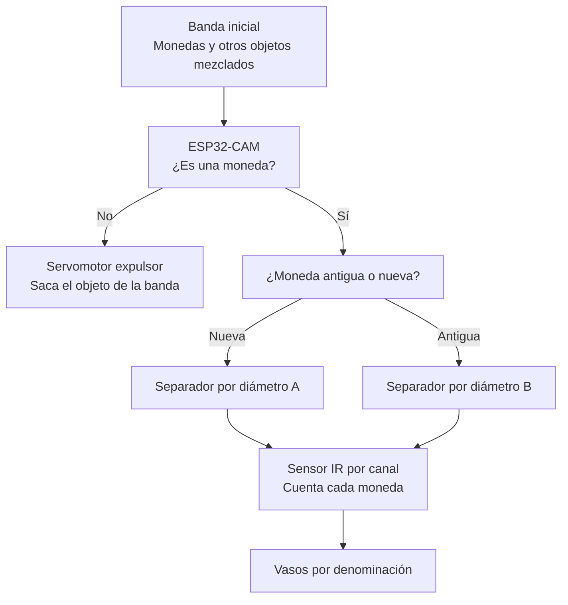

## Separador de monedas  


## 1. Banda inicial

Antes del separador hay una banda transportadora donde se colocan monedas de distintas denominaciones y épocas, junto con objetos que no son moneda (por ejemplo, botones). La banda lleva todo a velocidad constante hasta la zona de inspección y luego hacia los actuadores.

## 2. Detección de monedas con visión computacional

Una ESP32-CAM fotografía cada objeto al pasar por una zona con iluminación y fondo uniformes, y con OpenCV se decide si es una moneda o no. Como un botón también es redondo, no basta con detectar círculos; se combinan estos criterios:

- Diámetro en píxeles, dentro del rango de las monedas.
- Ausencia de agujeros internos (los botones suelen tener 2 o 4).
- Color y brillo metálicos.

La imagen se envía por Wi-Fi a un computador que ejecuta OpenCV y devuelve la decisión a la ESP32.

**Si no es moneda:** un servomotor con una paleta empuja el objeto fuera de la banda hacia un recipiente de rechazados. Como la cámara y el servomotor están separados una distancia *d* sobre la banda que avanza a velocidad *v*, el servomotor actúa con un retardo:

```
t_retardo = d / v
```

**Si es moneda:** sigue por la banda hacia la siguiente etapa.

## 3. Separación de monedas antiguas y nuevas

Las monedas de versiones anteriores a 2012 tienen medidas que se solapan con las actuales. Por ejemplo, la moneda de $100 antigua (23,0 mm) queda entre la de $200 nueva (22,4 mm) y la de $500 nueva (23,7 mm), y la de $200 antigua (24,4 mm) es más grande que la de $500 nueva. Un solo separador por diámetro las clasificaría mal, así que primero se separan por época.

La ESP32-CAM distingue antiguas de nuevas por el diámetro medido en píxeles y la apariencia de la moneda. Un servomotor con compuerta la desvía hacia uno de los dos separadores: uno calibrado con las medidas de las monedas nuevas y otro con las de las antiguas.

## 4. Clasificación por diámetro y conteo

Cada separador es una rampa impresa en 3D con aberturas cuyo ancho aumenta por tramos. La moneda se desliza por la rampa y cae por la primera abertura mayor que su diámetro, por lo que la más pequeña cae primero. Cada abertura se calcula así:

```
abertura = (diámetro de la moneda que debe caer + diámetro de la siguiente más grande) / 2
```

Debajo de cada abertura hay un compartimento con un sensor infrarrojo que cuenta cada moneda al caer, y la moneda queda en el vaso de su denominación.
---

Autores 

Lina María Moreno Ospina y Bryan Andrey Martínez 
